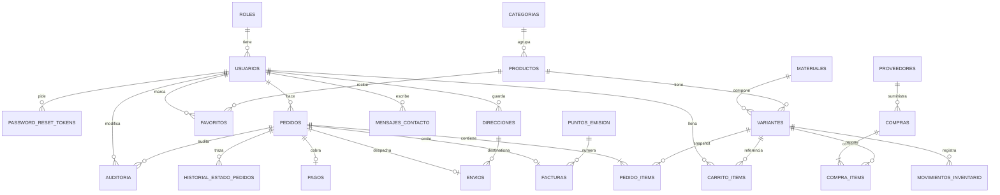

# 💎 Carresol — Joyería de lujo (Reto 2)

Tienda web de joyería full stack con **frontend MVC en JavaScript nativo**, **backend MVC en
Node.js/Express**, **PostgreSQL con Prisma** y el **modelo ER completo** de una tienda real:
catálogo con variantes (material/medida), carrito por variante, favoritos, pedidos con pago
simulado, facturación y envío, direcciones, contacto, **módulo de compras a proveedores** que
reponen inventario, auditoría de cambios y parámetros de sistema.

Todo el código, comentarios y textos de UI están **en español**.

---

## 🧱 Stack

| Capa | Tecnología |
|---|---|
| Frontend | HTML5 semántico + CSS3 (Grid/Flexbox, mobile-first) + JavaScript ES modules (sin frameworks) |
| Backend | Node.js + Express |
| BD | PostgreSQL 16 (Docker, instalación local o Supabase) |
| ORM | Prisma (schema + migraciones + seed idempotente) |
| Auth | JWT Bearer (HS256, expiración), roles `admin`/`user`, bcrypt |
| Pruebas | Smoke test end-to-end propio (81 comprobaciones) + E2E/accesibilidad con Playwright headless (37 + 31 comprobaciones) |

---

## 🏛️ Arquitectura MVC

### Flujo de una petición

```
[Vista] botón "Confirmar pedido"
   → [Controlador frontend] checkoutController.confirmarPedido()
   → [Modelo frontend] pedidoModel.crearPedido() → apiClient (fetch + Bearer)
   → HTTP POST /api/pedidos
   → [Ruta backend] routes/pedidos.js (validadores + authRequired)
   → [Middleware] validators.js (sanitiza) · auth.js (JWT + rol + contexto de auditoría)
   → [Controlador backend] pedidosController.confirmar()
   → [Modelo backend] pedidoModel.confirmarPedido() → prisma.$transaction(...)
   → [BD PostgreSQL] pedidos, pedido_items, pagos, facturas, envios,
      historial_estado_pedidos, auditoria, movimientos_inventario
   → respuesta JSON → [Vista] pinta el resumen del pedido (DOM APIs, sin innerHTML)
```

La regla de oro de ambos extremos: **las vistas solo pintan** (nunca hablan con la API ni
deciden), **los controladores orquestan** y **los modelos hablan con la API/BD**.

### Frontend

```
frontend/
├── index.html                 # SPA semántica con vistas en <section> ocultables
├── config.js                  # API_BASE_URL e IVA (debe coincidir con la BD)
├── assets/css/styles.css      # diseño Cartier/Tiffany + FASE 8 (detalle, checkout, admin…)
├── models/                    # hablan con la API (fetch)
│   ├── apiClient.js           # fetch + Bearer + errores tipados + 401 → evento sesión expirada
│   ├── authModel.js           # login/registro/sesión (sessionStorage)
│   ├── productoModel.js       # catálogo y detalle
│   ├── carritoModel.js        # carrito por varianteId (localStorage + revalidación)
│   ├── favoritosModel.js      # favoritos híbridos (invitado local / cuenta servidor)
│   ├── pedidoModel.js         # mis pedidos, cancelación
│   ├── direccionModel.js      # CRUD de direcciones
│   ├── contactoModel.js       # formulario de contacto
│   └── adminModel.js           # todas las consultas del panel admin
├── views/                     # SOLO pintan (createElement/textContent — anti-XSS)
│   ├── catalogoView.js, productoCard.js, productoDetalleView.js
│   ├── carritoView.js, checkoutView.js, pedidosView.js, cuentaView.js
│   ├── direccionFormView.js, contactoView.js, loginView.js, adminView.js
│   └── uiComponents.js        # toast, spinner, modal accesible (foco atrapado, Esc)
└── controllers/               # orquestan
    ├── appController.js       # arranque, router por hash (#/catalogo, #/cuenta…)
    ├── catalogoController.js  # filtros + paginación (8 por página)
    ├── carritoController.js   # dueño de paneles carrito/favoritos + modal de detalle
    ├── authController.js, checkoutController.js, cuentaController.js
    └── adminController.js     # 11 pestañas del panel admin
```

### Backend

```
server/
├── server.js / app.js        # arranque, helmet, CORS whitelist, rutas, errorHandler
├── routes/                   # 11 routers (auth, productos, carrito, favoritos,
│                             #  direcciones, pedidos, contacto, proveedores,
│                             #  compras, inventario, admin)
├── controllers/              # 9 controladores (orquestan modelo + respuestas)
├── models/                    # Prisma + reglas de negocio
│   ├── db.js                 # cliente único + auditoría automática ($extends)
│   ├── productoModel.js, varianteModel.js (dentro), usuarioModel.js,
│   ├── carritoModel.js, favoritoModel.js, direccionModel.js,
│   ├── pedidoModel.js        # confirmarPedido: TODO en una transacción
│   ├── compraModel.js        # recepción que suma stock una sola vez (idempotente)
│   ├── inventarioModel.js, contactoModel.js, auditoriaModel.js,
│   ├── parametroModel.js, passwordResetModel.js, rolModel.js, proveedorModel.js
├── middleware/               # auth (JWT/roles/authOpcional), validators, rateLimit, errorHandler
├── prisma/
│   ├── schema.prisma         # modelo ER completo (24 modelos @map a tablas snake_case)
│   ├── migrations/           # migración inicial (DDL PostgreSQL)
│   ├── seed.js               # seed idempotente
│   └── productos.json        # fuente de los 25 productos del catálogo
└── scripts/
    ├── smoke-test.js         # 81 comprobaciones end-to-end (npm test)
    ├── serve-frontend.js     # sirve el frontend estático en el origen del CORS
    └── ejemplos-endpoints.js # genera docs/evidencias/ejemplos-endpoints.md
```

---

## 🗄️ Modelo de datos (diagrama ER)



**Grupos del modelo:**

- **Usuarios y acceso:** `usuarios` (rol, cédula, `email_verificado`, `ultimo_login`,
  `password_hash`), `roles` (admin/user), `password_reset_tokens` (hash SHA-256 del token,
  30 min, un solo uso), `direcciones` (con `es_predeterminada`).
- **Catálogo:** `categorias`, `materiales`, `productos` (precio/stock **denormalizados** =
  derivado de sus variantes activas), `variantes` (SKU único, material × medida, precio y
  stock propios, `stock_minimo`).
- **Carrito y favoritos:** `carrito_items` (por variante, servidor) y `favoritos`
  (por producto). El cliente también mantiene carrito/favoritos locales para invitados.
- **Pedidos, pagos y facturación:** `pedidos` (totales congelados), `pedido_items`
  (**snapshots** de nombre/SKU/precio en el momento de la compra), `pagos` (pasarela
  **simulada**), `facturas` (clave de acceso de 49 dígitos simulada, numeración por
  `puntos_emision`), `envios` (snapshot de dirección), `historial_estado_pedidos`.
- **Compras (reposición de stock):** `proveedores`, `compras` (borrador → ordenada →
  recibida/cancelada), `compra_items`, `movimientos_inventario` (kardex de
  venta/compra/ajuste/devolución).
- **Soporte y sistema:** `mensajes_contacto` (bandeja con leído/sin leer), `auditoria`
  (tabla, registro, acción, datos anteriores/nuevos y **quién** hizo el cambio),
  `parametros_sistema` (IVA, costo de envío, secuenciales…), `puntos_emision`.

Los ids son `BigInt` en BD y **Number** en las respuestas JSON; los DECIMAL se devuelven
como Number. Los ENUMs son nativos de PostgreSQL con CHECKs adicionales en la migración.

---

## 🚀 Puesta en marcha (Windows/PowerShell, desde cero)

### 1. Requisitos

- **Node.js 20+** (`node -v`)
- **PostgreSQL 16**: cualquiera de estas tres opciones:
  - **Docker**: `docker compose --env-file server/.env up -d` (usa el `docker-compose.yml` del repo)
  - **Instalación local** de PostgreSQL (puerto 5432)
  - **Supabase** (PostgreSQL administrado; usa el pooler para la app y la cadena directa para migrar)

### 2. Configurar secretos

```powershell
cd server
Copy-Item .env.example .env
notepad .env
```

Edita `DATABASE_URL` / `DIRECT_URL`, `JWT_SECRET` (genera un secreto aleatorio de al menos
32 caracteres), `CORS_ORIGIN` y las contraseñas del seed. `server/.env` está ignorado por
git y **nunca** se comparte.

### 3. Instalar, migrar y sembrar

```powershell
cd server
npm install
npm run db:migrate     # prisma migrate dev (crea/aplica la migración inicial)
npm run db:seed        # seed idempotente: 5 categorías, materiales, 25 productos con
                       # variantes e imágenes, 2 usuarios, punto de emisión 001-001,
                       # dirección de ejemplo y parámetros del sistema
```

> Si la BD ya existiera de otra fuente: `npx prisma migrate deploy` aplica las migraciones
> sin abrir un entorno de desarrollo.

### 4. Arrancar

```powershell
npm start              # backend en http://localhost:3000
```

En otra terminal (el frontend debe servirse por HTTP en el origen del CORS, puerto 5500):

```powershell
cd server
node scripts/serve-frontend.js    # http://localhost:5500
```

(Alternativa equivalente: extensión *Live Server* de VS Code sobre `frontend/index.html`.)

### 5. URLs y credenciales de ejemplo

| URL | Qué es |
|---|---|
| `http://localhost:5500` | Tienda (catálogo público) |
| `http://localhost:3000/api/productos` | API (JSON) |

Credenciales de ejemplo (**en el proyecto real las genera el seed y solo viven en
`server/.env` y `docs/REPORTE_FINAL.md`**): `admin@carresol.com` (rol **admin**) y
`cliente@carresol.com` (rol **user**), con las contraseñas fuertes definidas en tu `.env`.

### 6. Pruebas

```powershell
cd server
npm test       # smoke test end-to-end: 81 PASS contra la BD real
```

---

## 🔌 Endpoints y roles

| Método y ruta | Rol | Descripción |
|---|---|---|
| `POST /api/auth/register` | público | Registro (role SIEMPRE `user`; cédula válida opcional) |
| `POST /api/auth/login` | público | Login → JWT (bloquea cuentas `activo=false`; actualiza `ultimo_login`) |
| `GET /api/auth/me` | JWT | Sesión actual |
| `POST /api/auth/forgot-password` | público | Token de recuperación (hash en BD, 30 min, un solo uso) |
| `POST /api/auth/reset-password` | público | Restablece la contraseña con el token |
| `GET /api/productos` | público | Catálogo (`?categoria=`, `?q=`, `?destacado=`, `?inactivos=true` solo admin) |
| `GET /api/productos/:id` | público | Detalle con variantes |
| `POST /api/productos` · `PUT` · `DELETE /api/productos/:id` | admin | CRUD de productos (baja lógica si tiene ventas) |
| `GET /api/carrito` · `PUT /api/carrito` | JWT | Carrito del servidor (sync completa) |
| `POST /api/carrito/items` · `DELETE /api/carrito/items/:varianteId` · `DELETE /api/carrito` | JWT | Carrito ítem a ítem |
| `GET /api/favoritos` · `POST` · `DELETE /api/favoritos/:productoId` | JWT | Favoritos |
| `GET /api/direcciones` · `POST` · `PUT /:id` · `DELETE /:id` | JWT | Direcciones propias (anti-IDOR) |
| `POST /api/pedidos` | JWT | Confirma pedido (transacción completa) |
| `GET /api/pedidos/mis-pedidos` | JWT | Mis pedidos |
| `GET /api/pedidos/:id` | propietario/admin | Detalle del pedido |
| `PATCH /api/pedidos/:id/estado` | propietario (cancelar) / admin | Cambio de estado (reglas) |
| `GET /api/pedidos` | admin | Todos los pedidos |
| `PATCH /api/pedidos/:id/pago` · `PATCH /api/pedidos/:id/envio` | admin | Confirma pago / registra envío |
| `POST /api/contacto` | público | Mensaje de contacto |
| `GET /api/contacto` · `PATCH /api/contacto/:id/leido` | admin | Bandeja de mensajes |
| `GET /api/proveedores` · `POST` · `PUT /:id` · `DELETE /:id` | admin | CRUD proveedores |
| `GET /api/compras` · `POST` · `GET /:id` · `PUT /:id` | admin | Compras (borrador/ordenada) |
| `PATCH /api/compras/:id/estado` | admin | Ordenar/recibir/cancelar (recibir = suma stock una vez) |
| `GET /api/inventario/stock-bajo` · `GET /api/inventario/movimientos` | admin | Stock bajo y kardex |
| `GET /api/admin/usuarios` · `GET /api/admin/pedidos` · `GET /api/admin/detalles` | admin | Vistas de tablas |
| `GET/POST/PUT /api/admin/categorias(/:id)` · `GET/POST/PUT /api/admin/materiales(/:id)` | admin | Catálogo base |
| `GET /api/admin/auditoria` · `GET /api/admin/resumen` | admin | Auditoría y resumen del negocio |
| `GET/PUT /api/admin/parametros(/:clave)` | admin | Parámetros del sistema |

---

## 🔐 Seguridad y riesgos OWASP mitigados

Medidas base: JWT HS256 con expiración y `JWT_SECRET` en `.env`; roles `admin`/`user`
verificados **en cada ruta** que lo exige; bcrypt (rondas configurables); CORS con
**whitelist** (el servidor se niega a arrancar si `CORS_ORIGIN=*`, `server/app.js:26-36`);
helmet (`server/app.js:24`); rate limit en login/registro/recuperación
(`server/middleware/rateLimit.js`); validación + sanitización con express-validator
(`server/middleware/validators.js`, `escape()` en textos); errores centralizados **sin
stacktrace** (`server/middleware/errorHandler.js`); y respuestas de login genéricas para
no filtrar si un correo existe (`server/controllers/authController.js:42-46`).

Riesgos OWASP Top 10 con su mitigación concreta:

1. **A01 Broken Access Control / IDOR** — cada ruta declara su rol
   (`requireRole('admin')`, `server/middleware/auth.js:98`) y los recursos propios
   verifican propiedad: direcciones (`server/models/direccionModel.js:55,73`) y pedidos
   (`server/models/pedidoModel.js:188,432`). El smoke test comprueba 403 de user a
   productos/pedidos y el anti-IDOR entre cuentas. En Supabase se activa **RLS en todas
   las tablas** mediante la migración `server/prisma/migrations/20261117000000_rls_public`
   (sin políticas: el rol `postgres` de Prisma la ignora y la API REST pública queda
   bloqueada).
2. **A02/A07 fallos de autenticación** — bcrypt con rondas configurables
   (`server/controllers/authController.js:8,21`), JWT con expiración, bloqueo de cuentas
   inactivas, rate limit, mensajes genéricos, y recuperación de contraseña con **hash
   SHA-256 en BD**, 30 minutos y **un solo uso** (`server/models/passwordResetModel.js`);
   la auditoría nunca persiste secretos (`server/models/db.js:28`).
3. **A03 Injection** — todas las consultas van por **Prisma parametrizado** (cero
   concatenación SQL) y la entrada se valida/sanitiza con express-validator. En el
   frontend las vistas construyen el DOM con `createElement`/`textContent` y **nunca
   `innerHTML`** (`frontend/views/uiComponents.js:2` y todas las vistas) → anti-XSS.
4. **A04 Insecure Design** — el **servidor recalcula** precios, IVA, envío y total en cada
   pedido (`server/models/pedidoModel.js`, `calcularTotales`) y toda la compra
   (stock atómico, snapshots, pago, factura, envío, historial, auditoría, vaciado del
   carrito) ocurre en **una transacción** (`prisma.$transaction` en `confirmarPedido`).
   La recepción de compras suma stock **exactamente una vez** (idempotente).
5. **A05 Security Misconfiguration** — CORS whitelist sin comodín, helmet, errores sin
   stacktrace, secretos solo en `server/.env` (fuera de git), y
   anti mass-assignment: el rol jamás se toma del body del registro
   (`server/controllers/authController.js:14-25`).

---

## ✅ Resultado de las pruebas (evidencias en `docs/evidencias/`)

Las **7 pruebas mínimas del Reto 2** (login admin → token; crear producto como admin;
user creando producto → 403; catálogo visible en el frontend; carrito funciona y persiste;
confirmar pedido como user → queda en BD; admin ve todos los pedidos) pasan, junto con todo
lo añadido:

- **Smoke test backend: 81 PASS / 0 FAIL** (`docs/evidencias/smoke-test.txt`) — contra el
  servidor y PostgreSQL reales: modelo ER completo, reglas de negocio, seguridad
  (401/403/409/422), pedidos transaccionales, compras, inventario, auditoría y
  recuperación de contraseña.
- **E2E del frontend: 37 PASS / 0 FAIL** (`docs/evidencias/e2e-frontend.txt`) — catálogo,
  detalle con selector material/medida, carrito por variante, favoritos, login y
  sincronización, checkout completo con pedido real, mi cuenta, sesión expirada y las 11
  pestañas del admin.
- **Accesibilidad: 31 PASS / 0 FAIL** (`docs/evidencias/accesibilidad.txt`) — teclado, foco,
  ARIA, contraste AA verificado en runtime y responsive; con 18 capturas en
  `docs/evidencias/capturas/`.
- **Línea base** previa a los cambios: `docs/evidencias/smoke-test-baseline.txt`.

---

## ⚙️ Variables de entorno (`server/.env`, ver `.env.example`)

| Variable | Qué hace |
|---|---|
| `NODE_ENV` | `development`/`production`; fuera de producción el token de recuperación se devuelve para poder probarlo |
| `PORT` | Puerto del backend (3000) |
| `DATABASE_URL` | Cadena PostgreSQL (Docker/local/Supabase pooler) |
| `DIRECT_URL` | Cadena directa para migraciones (Solo Supabase) |
| `JWT_SECRET` | Secreto de firma JWT (aleatorio, ≥32 caracteres) |
| `JWT_EXPIRES_IN` | Expiración de la sesión (`2h`) |
| `CORS_ORIGIN` | Orígenes del frontend separados por coma (sin `*`) |
| `HTTPS` | `true` solo con certificados en `server/certs/` |
| `BCRYPT_ROUNDS` | Costo de bcrypt (12) |
| `POSTGRES_PASSWORD` | Contraseña del contenedor PostgreSQL de docker-compose |
| `SEED_ADMIN_*` / `SEED_USER_*` | Nombre, correo y contraseña de los usuarios del seed |

---

## ♿ Accesibilidad aplicada

HTML semántico con `lang="es"`; skip-link; foco visible (`:focus-visible`); todo el flujo
operable por teclado (paneles y modales atrapan el foco, `Escape` cierra y devuelve el foco
al disparador); tablists ARIA con flechas en Mi cuenta y Admin; regiones `aria-live`
(avisos de variante, toasts `role=status`, errores `role=alert`); labels en todos los
controles; tablas con `th[scope]`; contraste AA verificado programáticamente (≥ 4.5:1);
`prefers-reduced-motion`; diseño responsive sin desbordamiento en 375px.

---

## 🧠 Decisiones de diseño (resumen; el detalle en `docs/DECISIONES.md`)

- **Precios/stock por variante**; los del producto son derivados de sus variantes activas.
- **Totales siempre en el servidor**; el checkout muestra un envío *estimado* y el
  servidor recalcula todo al confirmar.
- **Pago simulado**: `tarjeta` → aprobado al instante; `transferencia`, `deposito` y
  `contra_entrega` quedan `pendiente` hasta que un admin los confirma.
- **Facturación simulada**: numeración `001-001-XXXXXXXXX` por punto de emisión y clave de
  acceso de 49 dígitos generada (no electrónica ante el SRI).
- **Compras = reposición de inventario** a proveedores; recibir una compra suma stock una
  sola vez y lo registra en el kardex.
- **Favoritos híbridos**: local para invitados, sincronizados con la cuenta al iniciar
  sesión. **Carrito por variante** con tope `mín(10, stock)`.
- **Paginación del catálogo** de 8 productos por página (patrón del Reto 1 conservado).
- BigInt → Number y DECIMAL → Number al salir de los modelos (JSON plano).

## ⚠️ Limitaciones y mejoras futuras

- Sin servicio de correo real (recuperación y notificaciones); sin pasarela de pago real.
- Facturación simulada (no integra el SRI); el frontend no tiene vista de recuperación de
  contraseña (los endpoints están listos).
- Mejoras futuras: paginación en todos los listados, envío de correos, dashboard con
  gráficas, tests unitarios automatizados en CI.

## 🚢 Despliegue

| Pieza | Dónde | URL |
|---|---|---|
| Código | GitHub | https://github.com/jscrash22/carresol-fullstack |
| Base de datos | Supabase (`us-east-1`) | panel de Supabase (referencia `tdapkdknamqvucmoarqc`) |
| API | Render (`carresol-api`, free, Virginia) | https://carresol-api.onrender.com |
| Frontend | GitHub Pages | https://jscrash22.github.io/carresol-fullstack/ |

- **BD:** Supabase con el *Transaction pooler* en `DATABASE_URL` y el *Session pooler* en
  `DIRECT_URL`. Las migraciones incluyen la activación de RLS en todas las tablas.
- **Backend:** Render lee `render.yaml` (Blueprint). El plan gratis **se duerme tras ~15
  minutos sin uso**: la primera petición puede tardar hasta un minuto y el frontend lo
  avisa y reintenta solo.
- **Frontend:** GitHub Pages publica la carpeta `frontend` con la Action
  `.github/workflows/pages.yml`. La URL de la API se configura en `frontend/config.js`
  (`API_PROD_URL`) y el origen del sitio en `CORS_ORIGIN` del backend.

Guía paso a paso para principiantes: [`docs/DESPLIEGUE_RENDER.md`](docs/DESPLIEGUE_RENDER.md).
